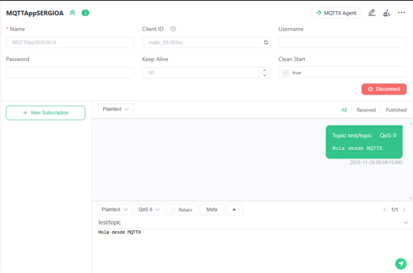
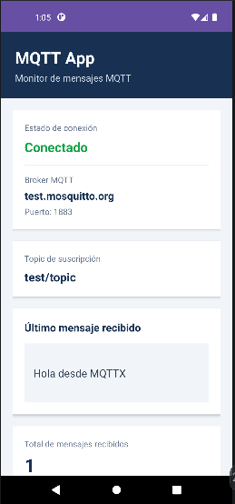
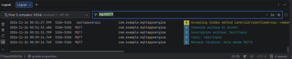

# MQTTAppSERGIOA

## Descripción del proyecto

Proyecto correspondiente a la Actividad 3.3: Manejo de MQTT,
de la asignatura Programación Android.

## Evidencias de funcionamiento

### 1. Conexión y publicación de mensajes mediante MQTTX

### 2. Funcionamiento de la aplicación en el emulador Android

### 3. Verificación de mensajes recibidos mediante Logcat

## Preguntas de cierre

### 1. ¿Qué aprendiste de la actividad realizada?

Aprendí a implementar MQTT en Android para recibir mensajes
en tiempo real.

### 2. ¿En qué ámbitos puedes utilizar o aplicar lo realizado en la actividad?

En sistemas IoT, automatización y monitoreo remoto de dispositivos.

### 3. ¿Pudiste realizar la conexión con MQTT?

Sí, logré establecer la comunicación MQTT utilizando MQTTX como publicador (Publisher), Mosquitto como intermediario (Broker) y la aplicación Android como suscriptor (Subscriber), recibiendo correctamente los mensajes en tiempo real.